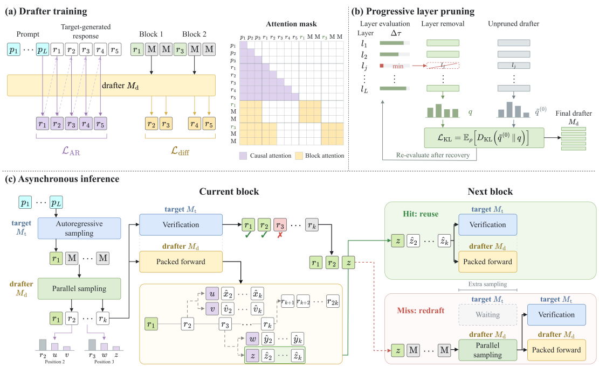

<h1 align="center">D3D</h1>

<h3 align="center">Decoupled Diffusion Drafting for Asynchronous Speculative Decoding</h3>

<p align="center">
  <strong>Diffusion drafts. The target verifies. D3D overlaps both.</strong><br>
  A decoupled draft-and-verify architecture, powered by Qwen3-derived diffusion drafts.
</p>

<p align="center">
  <a href="https://openreview.net/forum?id=owCZMqNsqR"></a>
  <a href="https://huggingface.co/collections/lingc8/d3d-6acc999de5b699dcf37b3c75"></a>
  <a href="#quick-start"></a>
  <a href="docs/architecture.md"></a>
  <a href="#benchmarking"></a>
</p>

<a id="overview"></a>

## ✨ Overview

**D3D** decouples a diffusion **draft model** from the **target verifier** on
separate GPUs. Draft generation overlaps target verification, with verification
feedback selecting reusable candidates for the next decoding step.

**The contribution is the D3D execution architecture:** independent drafting,
overlapped verification, and feedback-driven candidate reuse. **Qwen3 is the
transformer backbone**, not the name of the decoding system.

| Asynchronous execution | Parallel diffusion drafts | Single & concurrent |
|:---|:---|:---|
| Drafting and verification run on separate GPUs. | Block-wise candidate generation with packed outcomes. | Dedicated single-request and paged multi-request backends. |

<p align="center">
  
</p>

**How it works:** a target-selected anchor starts a parallel diffusion draft;
the target verifies the pending block while the draft GPU prepares possible
continuations; verification feedback selects the continuation to reuse.
See the [architecture guide](docs/architecture.md) for the execution flow.

<a id="model-zoo"></a>

## 🤗 Model Zoo

**[Browse the D3D collection →](https://huggingface.co/collections/lingc8/d3d-6acc999de5b699dcf37b3c75)**

Six Qwen3-derived draft checkpoints are grouped in **lingc8 / D3D**. These are
**draft models**, not replacements for the target models. `p` denotes pruning;
`24D` and `31D` denote the retained transformer-layer counts.

| Target verifier | Draft family | Layers | D3D checkpoint |
|:---|:---|:---:|:---|
| [Qwen3-8B](https://huggingface.co/Qwen/Qwen3-8B) | 1.7B | 28 | [D3D-1.7B-to-8B](https://huggingface.co/lingc8/D3D-1.7B-to-8B) |
| [Qwen3-8B](https://huggingface.co/Qwen/Qwen3-8B) | 8B | 36 | [D3D-8B-to-8B](https://huggingface.co/lingc8/D3D-8B-to-8B) |
| [Qwen3-8B](https://huggingface.co/Qwen/Qwen3-8B) | Pruned 8B | 31 | [D3D-31D-p8B-to-8B](https://huggingface.co/lingc8/D3D-31D-p8B-to-8B) |
| [Qwen3-32B](https://huggingface.co/Qwen/Qwen3-32B) | 1.7B | 28 | [D3D-1.7B-to-32B](https://huggingface.co/lingc8/D3D-1.7B-to-32B) |
| [Qwen3-32B](https://huggingface.co/Qwen/Qwen3-32B) | 8B | 36 | [D3D-8B-to-32B](https://huggingface.co/lingc8/D3D-8B-to-32B) |
| [Qwen3-32B](https://huggingface.co/Qwen/Qwen3-32B) | Pruned 1.7B | 24 | [D3D-24D-p1.7B-to-32B](https://huggingface.co/lingc8/D3D-24D-p1.7B-to-32B) |

> Checkpoints retain their original FP32 tensors; inference uses BF16.
> Each Hub repository includes tokenizer assets, inference compatibility code,
> a model card, and release metadata. The family size in a name is not an exact
> post-pruning parameter count. Exact source steps, tensor counts, and release
> compatibility notes are in [checkpoint details](docs/models.md).

<a id="installation"></a>

## 📦 Installation

The tested environment uses **PyTorch 2.6.0**, **Transformers 4.52.4**,
**FlashAttention 2.7.4.post1**, and **CUDA 12.x**. Python 3.10+ is supported;
local GPU validation used Python 3.11 and two NVIDIA H800 80 GB GPUs.

```bash
git clone https://github.com/linguancong524/D3D.git
cd D3D
python -m venv .venv
source .venv/bin/activate
pip install -r requirements.txt
pip install flash-attn==2.7.4.post1 --no-build-isolation
pip install -e . --no-deps
```

Install PyTorch before building FlashAttention. A matching prebuilt wheel can
be used instead; source builds need a CUDA toolkit, a C++ compiler, and
sufficient host memory. The concurrent backend requires FlashAttention.

<a id="quick-start"></a>

## 🚀 Quick Start

### 1. Select a target / draft pair

```bash
export CUDA_VISIBLE_DEVICES=0,1
export D3D_TARGET_MODEL=Qwen/Qwen3-8B
export D3D_DRAFT_MODEL=lingc8/D3D-1.7B-to-8B
```

The target runs on `cuda:0`, and the draft runs on `cuda:1`. Model IDs also
accept local checkpoint directories. Public model downloads do not require
a Hugging Face token.

### 2. Run asynchronous decoding

**Single request** — one MATH-500 sample, up to 128 generated tokens:

```bash
bash scripts/quickstart_single.sh
```

**Concurrent requests** — four samples at concurrency 4:

```bash
D3D_CONCURRENCY=4 bash scripts/quickstart_concurrent.sh
```

Results are saved under the Git-ignored `outputs/` directory.

<details>
<summary><strong>Use the 32B target with the 24-layer pruned draft</strong></summary>

```bash
export D3D_TARGET_MODEL=Qwen/Qwen3-32B
export D3D_DRAFT_MODEL=lingc8/D3D-24D-p1.7B-to-32B
bash scripts/quickstart_single.sh

D3D_PAGES=128 D3D_CONCURRENCY=4 bash scripts/quickstart_concurrent.sh
```

The 128-page setting was smoke-tested with a different local 24-layer
checkpoint, short generations, and two H800 GPUs. It is **not** a validated
capacity setting for the released 24-layer draft, long prompts, or
2048-token generations. See [GPU validation](docs/gpu-validation.md).

</details>

<details>
<summary><strong>Useful configuration options</strong></summary>

| Variable | Purpose | Default |
|:---|:---|:---|
| `D3D_TARGET_MODEL` | Target verifier path / Hub ID | `Qwen/Qwen3-8B` |
| `D3D_DRAFT_MODEL` | Draft checkpoint path / Hub ID | `lingc8/D3D-1.7B-to-8B` |
| `D3D_MAX_NEW_TOKENS` | Generation cap | 128 for quick starts; 2048 for benchmarks |
| `D3D_BLOCK_SIZE` | Single-request draft block size | 16 |
| `D3D_ANCHOR_NUM` | Single-request anchor candidate count | 3 |
| `D3D_CONCURRENCY` | Concurrent quick-start request count | 4 |
| `D3D_PAGES` | Concurrent KV pages per device | 512 |
| `D3D_DATA_CACHE` | Optional existing JSONL dataset cache | `data_cache/` |
| `D3D_BASELINE` | Run the single-GPU target-only AR baseline first (`0` disables) | `1` |

Use `python single/eval_async_packed.py --help` or
`python -m serving.bench --help` for the full set of options.

</details>

<a id="benchmarking"></a>

## 📊 Benchmarking

Run single-request evaluation over the standard datasets:

```bash
bash scripts/benchmark.sh
```

Run concurrent evaluation at request concurrency 1, 4, 8, and 16:

```bash
bash scripts/benchmark_concurrent.sh
```

Datasets are downloaded at runtime, not bundled in this repository.
LiveCodeBench v6 uses `test6.jsonl` from
`livecodebench/code_generation_lite`; the other datasets use `datasets`.
See the [benchmark protocol](benchmarks/README.md) for sources, splits,
token caps, timing boundaries, and reporting rules.

**Validation is not a performance claim.** Local GPU smoke and reference checks
are documented in [GPU validation](docs/gpu-validation.md). A full, verified
performance table for all six public checkpoints is not yet available.

## 📈 What a run reports

Every quick start and every benchmark writes a summary. Both first measure the
**baseline**: the target model alone, autoregressive, on one GPU, with the same
prompts, token cap, greedy settings, and concurrency as the D3D run.

The summary headline is these two metrics:

| Metric | Meaning |
|:---|:---|
| `speedup` | D3D tokens/s ÷ baseline tokens/s, measured on the same timing boundary for both sides |
| `accept_length` | Mean tokens committed per verify step (accepted draft tokens plus the target token) |

It also carries the raw throughput numbers (`d3d_tps` and `baseline_tps`),
dataset accuracy where a scorer exists, and the full timing/acceptance
breakdown:

- single request: `headline` block in `outputs/single/summary.json` for the
  quick start and in `outputs/benchmark/<dataset>.summary.json` for the
  benchmark;
- concurrent: every cell carries `baseline_tps`, `speedup`, and
  `accept_length`, and the top-level `summary` list collects them per
  dataset × concurrency.

Both sides of `speedup` always share the same timing boundary: single-request
runs compare decode-only TPS (prefill and the prefill-emitted first target
token excluded), while concurrent runs compare end-to-end TPS (prefill,
admission, decode, and drain included). The two boundaries are not comparable.
Single-request summaries record this in `headline.metric`; concurrent cells
record it as `timing_boundary`.

Set `D3D_BASELINE=0` (scripts) or `--no-baseline` (Python entry points) to skip
the baseline. `speedup` is then left empty and the D3D run itself is unchanged.

## 🗂️ Repository Guide

```text
single/       Single-request asynchronous draft-and-verify decoding
serving/      Concurrent decoding, paged KV cache, and AR baselines
models/d3d/   Qwen3-derived D3D draft backbone and compatibility code
scripts/      Quick starts, smoke checks, and benchmark entry points
benchmarks/   Dataset sources and evaluation protocol
docs/         Architecture, model details, and validation notes
tests/        Model-loading, release, and metric-accounting checks
```

## Citation & License

If D3D is useful in your research, please cite the
[paper](https://openreview.net/forum?id=owCZMqNsqR).
[CITATION.cff](CITATION.cff) describes this software repository; consult the
paper for the author list and publication details.

D3D-authored code is released under the [MIT License](LICENSE). Included
third-party code and Qwen-derived weights retain their own terms; see
[THIRD_PARTY_NOTICES.md](THIRD_PARTY_NOTICES.md) and the individual model cards.
